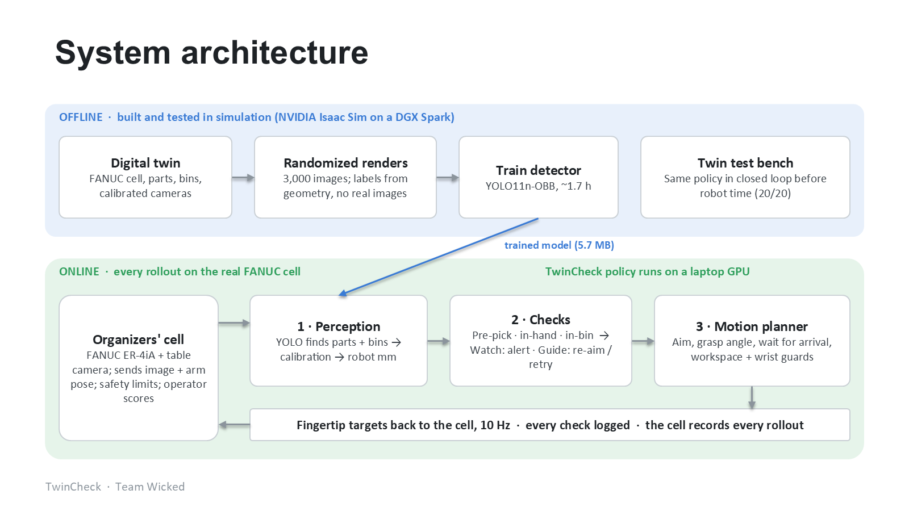

# TwinCheck

**Team Wicked (Arshdeep Singh, Rohan Gaikwad, Adam Erickson) · Rockwell Automation + NVIDIA Physical AI Hackathon, Fall 2026 · Dataset 3: Grasping and Sorting**

A taught robot program is blind: if a part sits a couple of centimetres off its taught spot, the arm grabs air or
crashes, and nobody notices. TwinCheck gives the FANUC ER-4iA eyes and a checker. Before every pick it finds the
part with a camera, and after every pick it checks that the part was held and landed in the right bin. Its detector was
trained **only on images rendered in the Isaac Sim digital twin**; no real image was used for training.

## Results on the real cell

The organizers' operator scored both runs on the same 10 layouts (2 cubes and 1 M6 screw into two bins, with parts
placed up to 3 cm off the taught spots), Oct 30, 2026.

| Measure | Blind taught program | TwinCheck Guide |
| --- | --- | --- |
| Rollouts fully sorted | 0 / 10 | **9 / 10** |
| 95% confidence interval (Wilson) | 0-28% | **60-98%** |
| Controller faults | 7 | **1** |
| Operator interventions | 0 | 0 |
| Average time per 3-part sort | - | 96.5 s |

Running alongside the blind program (Watch mode), TwinCheck flagged all 20 of its picks as "will likely miss" before
the arm moved, and 19 of them did.

### Every rollout, baseline vs Guide

Each clip is cut from the cell's own recording, so the top, wrist and side cameras are in sync. The top bar shows the
official score, and the bottom bar shows TwinCheck's live log (green = check passed, red = check failed). Baseline clips
play at real speed and Guide clips at 2x. Rollout N used the same layout in both runs.

| Rollout | Blind baseline (`r20261030-dcd07a`) | Watch flags | Video | TwinCheck Guide (`r20261031-79333b`) | Checks passed | Video |
| --- | --- | --- | --- | --- | --- | --- |
| 1 | Fail (controller fault), 50 s | 4 of 4 checks failed | [clip](https://github.com/rohan9607/Twincheck-Nvidia-Hackathon/blob/main/submission/rollouts/baseline/rollout_01.mp4) | **Success**, 109 s | 9 of 9 | [clip (2x)](https://github.com/rohan9607/Twincheck-Nvidia-Hackathon/blob/main/submission/rollouts/guide/rollout_01.mp4) |
| 2 | Fail (controller fault), 78 s | 7 of 7 checks failed | [clip](https://github.com/rohan9607/Twincheck-Nvidia-Hackathon/blob/main/submission/rollouts/baseline/rollout_02.mp4) | **Success**, 92 s | 8 of 8 | [clip (2x)](https://github.com/rohan9607/Twincheck-Nvidia-Hackathon/blob/main/submission/rollouts/guide/rollout_02.mp4) |
| 3 | Fail (controller fault), 14 s | 1 of 1 checks failed | [clip](https://github.com/rohan9607/Twincheck-Nvidia-Hackathon/blob/main/submission/rollouts/baseline/rollout_03.mp4) | **Success**, 102 s | 9 of 9 | [clip (2x)](https://github.com/rohan9607/Twincheck-Nvidia-Hackathon/blob/main/submission/rollouts/guide/rollout_03.mp4) |
| 4 | Fail, 93 s | 7 of 9 checks failed | [clip](https://github.com/rohan9607/Twincheck-Nvidia-Hackathon/blob/main/submission/rollouts/baseline/rollout_04.mp4) | **Success**, 100 s | 9 of 9 | [clip (2x)](https://github.com/rohan9607/Twincheck-Nvidia-Hackathon/blob/main/submission/rollouts/guide/rollout_04.mp4) |
| 5 | Fail (controller fault), 14 s | 1 of 1 checks failed | [clip](https://github.com/rohan9607/Twincheck-Nvidia-Hackathon/blob/main/submission/rollouts/baseline/rollout_05.mp4) | **Success**, 100 s | 9 of 9 | [clip (2x)](https://github.com/rohan9607/Twincheck-Nvidia-Hackathon/blob/main/submission/rollouts/guide/rollout_05.mp4) |
| 6 | Fail, 96 s | 9 of 9 checks failed | [clip](https://github.com/rohan9607/Twincheck-Nvidia-Hackathon/blob/main/submission/rollouts/baseline/rollout_06.mp4) | **Success**, 89 s | 7 of 8 | [clip (2x)](https://github.com/rohan9607/Twincheck-Nvidia-Hackathon/blob/main/submission/rollouts/guide/rollout_06.mp4) |
| 7 | Fail, 97 s | 9 of 9 checks failed | [clip](https://github.com/rohan9607/Twincheck-Nvidia-Hackathon/blob/main/submission/rollouts/baseline/rollout_07.mp4) | **Success**, 88 s | 7 of 8 | [clip (2x)](https://github.com/rohan9607/Twincheck-Nvidia-Hackathon/blob/main/submission/rollouts/guide/rollout_07.mp4) |
| 8 | Fail (controller fault), 43 s | 4 of 4 checks failed | [clip](https://github.com/rohan9607/Twincheck-Nvidia-Hackathon/blob/main/submission/rollouts/baseline/rollout_08.mp4) | Fail (controller fault), 76 s | 6 of 7 | [clip (2x)](https://github.com/rohan9607/Twincheck-Nvidia-Hackathon/blob/main/submission/rollouts/guide/rollout_08.mp4) |
| 9 | Fail (controller fault), 13 s | 1 of 1 checks failed | [clip](https://github.com/rohan9607/Twincheck-Nvidia-Hackathon/blob/main/submission/rollouts/baseline/rollout_09.mp4) | **Success**, 94 s | 9 of 9 | [clip (2x)](https://github.com/rohan9607/Twincheck-Nvidia-Hackathon/blob/main/submission/rollouts/guide/rollout_09.mp4) |
| 10 | Fail (controller fault), 14 s | 1 of 1 checks failed | [clip](https://github.com/rohan9607/Twincheck-Nvidia-Hackathon/blob/main/submission/rollouts/baseline/rollout_10.mp4) | **Success**, 95 s | 8 of 8 | [clip (2x)](https://github.com/rohan9607/Twincheck-Nvidia-Hackathon/blob/main/submission/rollouts/guide/rollout_10.mp4) |

The baseline ran in Watch mode, so its checks only warn and never steer. In Guide, a check can fail inside a successful
rollout, for example when a part stacked in the bin hides the one below it from the camera.

More evidence:
- Longer, higher-resolution clips of rollout 1: [baseline](https://github.com/rohan9607/Twincheck-Nvidia-Hackathon/blob/main/submission/evidence/evidence_baseline_r1.mp4) ·
  [Guide](https://github.com/rohan9607/Twincheck-Nvidia-Hackathon/blob/main/submission/evidence/evidence_guide_r1.mp4)
- Rollout 1 layout, taught spots vs measured positions: [baseline](https://github.com/rohan9607/Twincheck-Nvidia-Hackathon/blob/main/submission/evidence/layout_baseline.png) ·
  [Guide](https://github.com/rohan9607/Twincheck-Nvidia-Hackathon/blob/main/submission/evidence/layout_guide.png)
- Every check of every real rollout: [`runs/cell/real_s5_blind_v2.jsonl`](runs/cell/real_s5_blind_v2.jsonl),
  [`runs/cell/real_s6_guide_v6.jsonl`](runs/cell/real_s6_guide_v6.jsonl); client logs in [`submission/logs/`](submission/logs/)
- Summary: [`submission/TwinCheck_Summary.pdf`](submission/TwinCheck_Summary.pdf) · presentation:
  [`submission/TwinCheck_Wicked_presentation.pptx`](submission/TwinCheck_Wicked_presentation.pptx) (open in desktop PowerPoint to play its videos)

## How it works



1. **Digital twin (offline).** NVIDIA Isaac Sim 6.0 runs the organizers' FANUC ER-4iA cell, with cameras placed by
   their calibration so the twin sees what the real camera sees. Omniverse Replicator renders randomized images
   (part pose and colour, bins anywhere, lighting, clutter, distractors, camera jitter, noise) with labels projected from the 3D geometry.
2. **Detector.** An Ultralytics YOLO11n-OBB (2.66 M parameters, 5.7 MB) finds cubes, screws and bins with their angles.
   v4 was trained on 3,000 twin images at 1280 px for 60 epochs on an NVIDIA DGX Spark ([`models/`](models/)).
3. **Policy on the real cell.** [`cell_policy/`](cell_policy/) answers the organizers' `act(obs)` 10 times a second.
   It aims at where each part really is, waits for the arm to arrive, and runs three checks per pick:

   | When | Question | Evidence |
   | --- | --- | --- |
   | Before the grab | Is the part where the robot will grab? | Top camera |
   | After the grab | Is the part held? (the gripper has no part sensor) | Top camera: the part left the table |
   | After the drop | Did it land in the right bin? | Top camera |

4. **Three modes.** *Baseline* is the taught program. *Watch* is the same motion with alerts, and bolts on without
   reprogramming. *Guide* makes camera-guided picks and retries a missed grasp.

Before every real slot, the same policy ran closed-loop against the twin (`sim/twin_cell.py`, `cell_policy/eval_twin.py`).
Every real failure was diagnosed from the recordings, reproduced in the twin, and fixed there first.

## What's in the repo

```
config/twincheck.yaml   one config: objects, bins, pick points, thresholds, cameras, safety limits
twincheck_core/         pure-Python logic: checks, pick loop (baseline | watch | guide), cell guards, stats; 56 tests
cell_policy/            TwinCheck as the organizers' policy.py, perception, placement layouts, twin evaluation
sim/                    Isaac Sim: twin cell, synthetic data (Replicator), finger fit, twin runtime
perception/             training, label checks, evaluation, TensorRT export
models/                 detector versions v1-v4
runs/cell/              logs of every mock, twin and real run
submission/             summary, presentation, evidence clips, rollout clips, logs
ros2_ws/, calib/, dashboard/, db/, scripts/, docs/   ROS 2 pipeline, calibration tools, operator dashboard, results database
```

To run the tests: `cd twincheck_core && python -m pytest -q`.

## Safety and data rules we followed

- The real arm was driven only through the organizers' client, in operator-supervised slots.
  `twincheck_core/twincheck_core/cell.py` refuses any target outside the reach, the TCP box, the table, or the wrist-turn limit.
- Real recordings were used only for testing and diagnosis, never for training.
- No keys, passwords, tokens or private result links are in this repo.

## Limits

Ten rollouts per condition is a small sample. The arm is speed-capped (about 55 mm/s). Parts stacked in one bin can hide
each other from the camera. Only parts that fit the 12 mm jaws (10 mm cubes and M6 screws) were tested.
